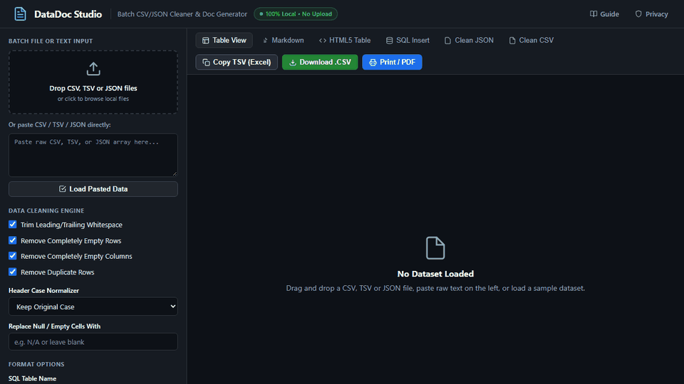
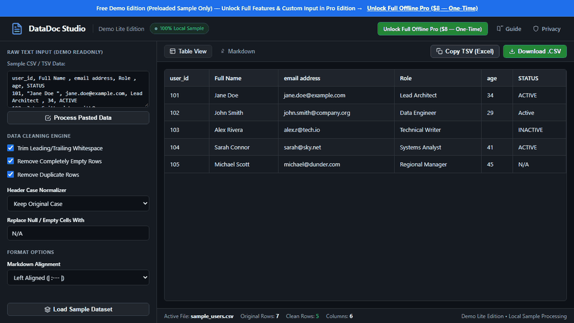

# DataDoc Studio

Offline batch CSV and JSON table cleaner, Markdown, and PDF documentation generator built for developers who need fast data transformation without cloud latency or security overhead.

## Full Pro Edition Preview

Get the complete offline bundle here: [Get the Full Offline Pro Edition](https://bobservice.gumroad.com/l/datadoc-studio?utm_source=github)

## Free Live Demo Preview

Test the interactive workspace in your browser: [Try the Free Live Demo](https://nexusmedialab04-art.github.io/datadoc-studio/)

---

## Free Demo vs Full Pro Edition

| Feature / Capability | Free Live Demo (`index_lite.html`) | Full Pro Edition (`index_pro.html`) |
| :--- | :--- | :--- |
| **Data Ingestion** | Pasted Data & Sample Dataset | File Inputs, Pasted Data & Sample Dataset |
| **Interactive Views** | Table View & Markdown | Table View, Markdown, HTML5 Table, SQL Insert |
| **Data Cleaning** | Clean JSON, Clean CSV, Copy TSV (Excel), Download .CSV | Clean JSON, Clean CSV, Copy TSV (Excel), Download .CSV, Print / PDF |
| **Header Case Normalization** | Keep Original Case | Keep Original Case, `snake_case`, `camelCase`, `kebab-case`, Title Case, UPPERCASE |
| **Markdown Alignment** | Left Aligned (`| :--- |`) | Left Aligned, Center Aligned (`| :---: |`), Right Aligned (`| ---: |`) |
| **Execution Environment** | 100% Client-Side Browser Engine | 100% Client-Side Browser Engine (Offline Ready) |

---

## Technical Stack

- **Pure Vanilla JavaScript:** Zero external dependencies, npm packages, or cloud backend requirements.
- **Client-Side Processing:** All computations execute locally in the browser DOM.
- **Privacy First:** Zero data transmission or external server logging.